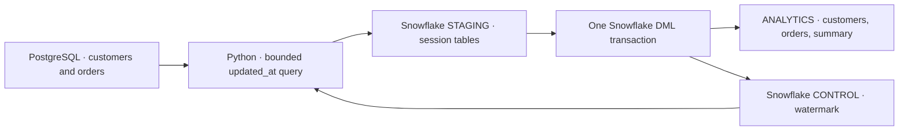

# PostgreSQL to Snowflake Incremental Pipeline

Sync synthetic customers and orders from PostgreSQL to Snowflake. The
first run reads the initial dataset. Later runs read changes based on
`updated_at` and a durable watermark.



## Windows setup

From the repository root in PowerShell:

```powershell
py -3.14 -m venv .venv
.\.venv\Scripts\python.exe -m pip install -r requirements.txt
if (!(Test-Path .env)) { Copy-Item .env.example .env }
.\.venv\Scripts\python.exe -m pytest -q
```

Choose a local PostgreSQL password in `.env`. If Docker Desktop with
Compose is available, start the bundled PostgreSQL instance:

```powershell
docker compose up -d
docker compose exec postgres pg_isready -U demo -d incremental_demo
```

For a native PostgreSQL installation, create a dedicated login and
database owned by that login using pgAdmin or `psql`. Set `PGHOST`,
`PGPORT`, `PGDATABASE`, `PGUSER` and `PGPASSWORD` in `.env` to match.
This demo expects exclusive use of its source tables in that database.

## Demonstrate the pipeline

Fill in `SNOWFLAKE_ACCOUNT` and `SNOWFLAKE_USER` in your local `.env`.
The defaults use `OAUTH_AUTHORIZATION_CODE`, `SYSADMIN`, and the existing
`COMPUTE_WH`. Verify that the warehouse is X-Small with auto-suspend.
Use the OAuth values required by your Snowflake integration if it uses a
custom client, endpoints or redirect URI. Follow the browser prompt and
sign in through your configured Google identity provider. Each CLI command
opens a new connection and may prompt for sign-in. Keep OAuth credentials
in the local environment and keep `.env` out of Git.

The setup creates objects only in this project's database. The role needs
permission to create that database and use the warehouse. See the
[Snowflake connector authentication guide](https://docs.snowflake.com/en/developer-guide/python-connector/python-connector-connect).

```powershell
$python = ".\.venv\Scripts\python.exe"
& $python main.py init-source
& $python main.py seed
& $python main.py init-target
& $python main.py sync
& $python main.py change
& $python main.py sync
& $python main.py sync
& $python main.py verify
```

Use a fresh source and target for this sequence. Check each command's
exit code before continuing. Expected log counts on fresh data:

| Run | Customers extracted | Orders extracted |
| --- | ---: | ---: |
| Initial | 3 | 4 |
| After the change script | 2 | 0 |
| With no further changes | 0 | 0 |

The change script moves customer 1 to Brasov and inserts customer 4.
Both rows share an `updated_at` value and the script is safe to repeat.
Verification should show four distinct customer IDs, four distinct order
IDs, zero orphan orders, and a persisted watermark. The customer summary
should show customer 1 in Brasov and customer 4 with zero orders.
Use `docker compose stop` to stop the local service and retain its data.

## Watermark and transaction design

The first run reads all current rows older than the upper bound. On
subsequent runs the filter is `updated_at >= previous_upper AND
updated_at < current_upper`. The lower bound is inclusive. The upper
bound is exclusive, so every row at that timestamp is eligible next run.
Ordering by `updated_at, id` makes ties deterministic without cutting
through a group at the watermark.

PostgreSQL triggers assign timestamps using the database clock after
writers have acquired their table lock. Short SHARE locks drain active
writes and block new writes while Python captures the upper bound and
reads both tables. This prevents a write with an older timestamp from
committing after the extraction window. It assumes the source clock
does not move backward and the source triggers stay enabled. The locks,
in-memory batches, and fixed source-to-target mapping suit a small
demonstration. A PostgreSQL advisory lock serializes sync runs for the
same source database.

Each sync opens a new Snowflake session. The loader creates empty,
session-local staging tables before beginning the
warehouse transaction because Snowflake DDL auto-commits. The transaction
then stages each batch, merges by primary key, and records the new
watermark in CONTROL. These changes commit together. A failed run leaves
the previous committed watermark available for retry. Replaying a batch
uses the existing target IDs and cannot overwrite a row with an older
timestamp. Keep the configured source tied to this target database.
An empty extraction advances the completed time window and leaves the
analytics rows alone.

## Full load, incremental load, and CDC

A full load reads the complete source dataset. This timestamp-based
incremental load polls for the latest version of inserted or updated
rows. PostgreSQL log-based CDC reads change events from the write-ahead
log and can capture deletes, repeated updates, and commit ordering
with an appropriate publication and replication consumer. This demo
copies current row state, so intermediate changes and hard deletes
are outside its scope.

## Test against PostgreSQL only

The default pytest run uses mocks for warehouse calls. To include the
real PostgreSQL integration test, create an empty, disposable database
(e.g. `incremental_test`). The test creates and populates two demo tables
and requires a fresh database for each run. Set `PGHOST`, `PGPORT`,
`PGDATABASE`, `PGUSER`, and `PGPASSWORD` in the PowerShell process
environment because pytest does not load the repository's `.env`:

```powershell
$env:PGDATABASE = 'incremental_test'
$env:RUN_POSTGRES_INTEGRATION = '1'
.\.venv\Scripts\python.exe -m pytest -q
Remove-Item Env:RUN_POSTGRES_INTEGRATION
Remove-Item Env:PGDATABASE
```

## Verified live results

On 20 November 2026, the demo ran end to end from native PostgreSQL 17.12
to Snowflake with `SYSADMIN` and `COMPUTE_WH`. STAGING, CONTROL, and
ANALYTICS were present in the dedicated target.

| Run | Customers extracted | Orders extracted | Target customers | Target orders |
| --- | ---: | ---: | ---: | ---: |
| Initial | 3 | 4 | 3 | 4 |
| After insert and update | 2 | 0 | 4 | 4 |
| Without source changes | 0 | 0 | 4 | 4 |

Snowflake contained both customer changes with the same `updated_at`.
Verification found four distinct IDs in each target table, zero orphan
orders, and one persisted watermark that advanced after each successful
window. The summary showed customer 1 in Brasov with two orders and
customer 4 in Timisoara with zero orders.

The first live attempt exposed a connector limitation on
`executemany` with `INSERT … SELECT`. The retry verified that the
failed run had left the analytics tables and watermark empty.
The corrected loader uses individual bound inserts into temporary
staging tables, which suit the small demo batches.

The final pytest run passed all 9 tests, including the real PostgreSQL
integration test for tied timestamps at the exact lower boundary.
The transaction unit tests use mocks. The live run used a native
loopback PostgreSQL instance. The Compose path was untested.

See [interview preparation](docs/interview_prep.md) and [CV bullets](docs/cv_project_bullets.md).
